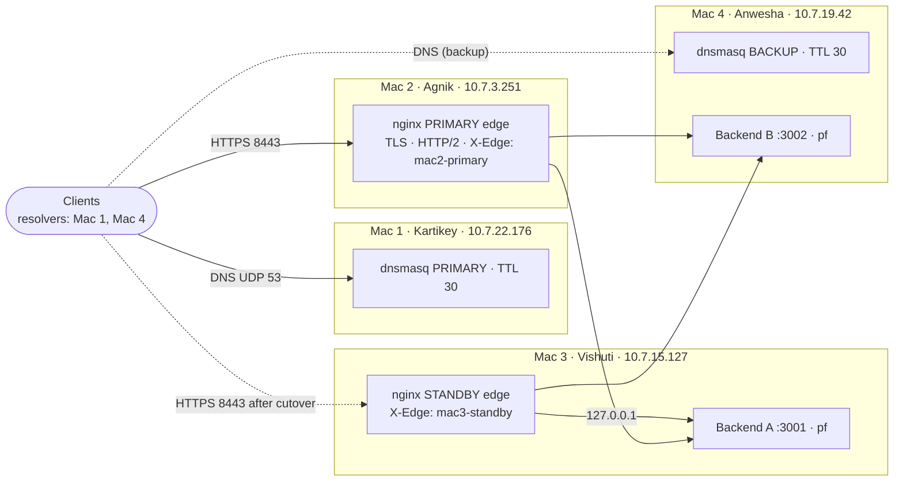

# Phase 2 Final Report: Team Axis, Section D

**Private Network Service Platform: Harden & Recover**
Team: Kartikey (Mac 1) · Agnik (Mac 2) · Vishuti (Mac 3) · Anwesha (Mac 4)
Domain: `app.cnteam.test`, `api.cnteam.test` · Edge: nginx on 8080 → 8443 (TLS) · Tests run 22 Nov 2026

> Companion documents: [study guide](https://github.com/Jitmisra/cn-guide) (how everything works, viva prep),
> [`ARCHITECTURE.md`](./ARCHITECTURE.md) (topology), [`EVIDENCE_INDEX.md`](./EVIDENCE_INDEX.md) (every evidence file).

---

## 0. Summary

Phase 1 built a working private service: our own DNS → an nginx edge that terminates TLS and load-balances →
two backends. Phase 2 extends the same network to keep working while parts of it fail. We added a backup DNS
server, made DNS caching visible with a 30 s TTL, firewalled the backends so only the edge tier can reach them,
tuned and proved nginx failover, and migrated traffic to a standby edge purely by changing DNS. All results
below come from live tests on the four Macs, with timestamps and evidence files.

| Extension | Result |
|---|---|
| **A** Backup DNS | ✅ Primary stopped → clients resolved through Mac 4. Contrast: DNS down = `Resolving timed out` while the edge answers by IP. Backends down = DNS + TLS fine, HTTP 502 |
| **B** TTL + record change | ✅ Client kept the old answer for ≈30 s after the change, then switched. Manual flush = instant |
| **C** Service isolation | ✅ 3001 refused (`block return`) and 3002 timed out (`block drop`) from a client, edge kept access. Rollback on both, confirmed from Mac 1 at 19:36:23 |
| **D** HA failover | ✅ Backend A down 46 s → **252/252 requests HTTP 200**. nginx retried A→B inside the same request |
| **E** Edge migration | ✅ Two cutovers to the standby edge, client flip 27–30 s (= TTL), **0 failed requests** (90 + 105) |
| **F** Troubleshooting | ✅ Layered method + tools ready. A real silent DNS fault found and fixed. Faculty fault happens at the evaluation |

## 1. Network on test day

| Machine | Owner | Phase 2 roles | IPv4 on 22 Nov (Phase 1 IP) |
|---|---|---|---|
| Mac 1 | Kartikey | Primary DNS, test client, cutover driver | 10.7.22.176 (10.7.8.82) |
| Mac 2 | Agnik | Primary edge: nginx LB + TLS, coordinator | 10.7.3.251 (10.7.14.242) |
| Mac 3 | Vishuti | Backend A :3001, standby edge | 10.7.15.127 (10.7.18.246) |
| Mac 4 | Anwesha | Backend B :3002, backup DNS, test client | 10.7.19.42 (10.7.5.197) |

All four sit on campus Wi-Fi `10.7.0.0/19`, gateway `10.7.0.1`. **Every IP changed between Phase 1 and Phase 2**
(DHCP). That turned into one of our findings (§4).

## 2. What changed from Phase 1

| Area | Phase 1 | Phase 2 | Config / code |
|---|---|---|---|
| DNS | one dnsmasq (Mac 1), `local-ttl` 0 (no caching) | + identical backup on Mac 4, `local-ttl=30` on both, clients list both, interface-based listening (survives IP changes) | `mac1-kartikey-dns/config/`, `backend_b/config/cnteam.conf` |
| Edge | hand-written config, `max_fails=2 fail_timeout=5s` | one template for both edges: `max_fails=1 fail_timeout=10s`, `proxy_next_upstream … tries 2`, connect 2 s / read 5 s, `X-Edge` header, HTTP/2, access log with `$upstream_addr` | `mac2-agnik-nginx-edge/config/edge.conf.tmpl` |
| Standby edge | none | nginx on Mac 3 from the same template, same cert + key, local Backend A | `mac2-agnik-nginx-edge/standby-edge/` |
| Backends | `/`, `/api/status`, `Cache-Control` | + `/api/info` with an ETag that is **identical on A and B** → 304 from either. Correct `HEAD` (Backend B used to return 501) | `backend_a/backend_a.py`, `backend_b/backend_b.py` |
| Isolation | backend ports open to the whole LAN | pf: only the edge tier (Mac 2, Mac 3) reaches 3001/3002. Mac 3 uses an anchor + `block return`, Mac 4 uses port-only rules + drop. Rollback scripts on both | `backend_a/config/pf.*.tmpl`, `backend_b/config/pf_rules_isolation.conf` |
| Evidence path | some scripts used `curl -k --resolve` | every Phase 2 evidence script uses real DNS + the trusted cert, **no `-k`** | `mac2-agnik-nginx-edge/scripts/` |
| Diagnosis | per-machine scripts | team-wide layered tools + live team board | `tools/diagnose.sh`, `mac2-agnik-nginx-edge/scripts/team-check.sh` |

## 3. Resilience tests and results

| Test | Expected | Observed | Pass | Evidence |
|---|---|---|---|---|
| **A** primary DNS stopped | clients resolve via Mac 4 | Mac 1 dnsmasq stopped 19:05:00. `dig @Mac1` timed out (pcap: ICMP port unreachable). `nslookup` → `Server: 10.7.19.42`, answer 10.7.3.251. 3× curl by name, no `-k` → HTTP/2 200 (A, B, A) via `mac2-primary`. Primary restarted 19:05:13 | ✅ | `mac1-kartikey-dns/evidence/phase2/A-backup-failover-20261122-190456.txt`, `A-failover-*-{lo0,en0}.pcap`, `backend_b/evidence/phase2/A-backup-dns-dig.txt` |
| **A** both DNS stopped (contrast) | resolution fails, edge reachable by IP | Mac 1 stopped 19:38:17, Mac 4 down by 19:38:28 (3 missed queries). Both `dig`s timed out. curl by name: `Resolving timed out after 8000 ms`. Same edge by IP: `nc :8443` open, HTTP/2 200 → **DNS-layer failure, app healthy**. Both DNS back by 19:40:12 | ✅ | `mac1-kartikey-dns/evidence/phase2/A-dns-vs-app-failure.txt` |
| **A** both backends stopped (contrast) | resolves + TLS OK, 502 | A stopped 19:40:44, B shortly after. At 19:42:50 `dig` + `dscacheutil` → 10.7.3.251, `nc :8443` open, TLS 1.3 `SSL certificate verify ok` (no `-k`), **HTTP/2 502** → **application-layer failure, DNS fine**. Both backends restarted by 19:44:32 | ✅ | same file (an earlier 19:23 run was marked INVALID and redone) |
| **B** record change, wait | old answer ≤30 s, then new | TTL 0 → 30 confirmed on the wire. Change 18:39:44; `dig` new at once; OS cache old until 18:40:20, new 18:40:23 (≈30 s) | ✅ | `mac1-kartikey-dns/evidence/phase2/B-ttl-20261122-183943.txt`, `B-ttl-onwire-*.txt` |
| **B** record change, flush | new answer immediately | reverted 18:40:36 (cache still stale 18:40:38), flushed 18:40:39 → next lookup correct | ✅ | same |
| **C** client → 3001 (Mac 3) | blocked | before 19:02:23: open. After 19:10:43: **Connection refused** (pf `block return`). Site still 200 A/B | ✅ | `mac1-kartikey-dns/evidence/phase2/C-client-blocked.txt` |
| **C** client → 3002 (Mac 4) | blocked | ~18:53 from Mac 1: **Operation timed out** (pf drop). Side effect: the first pf load also blocked Mac 4's *own* outgoing traffic, so the rules were rewritten as port-only + `pass out … keep state`. The corrected ruleset was not re-tested from Mac 1 before rollback | ✅ | `backend_b/evidence/phase2/C-isolation-3002.txt` |
| **C** edge → backends | allowed, LB alternates | Mac 2 → 3001 and 3002 open, HTTP 200, through the edge A B A B A B | ✅ | `mac2-agnik-nginx-edge/evidence/phase2/C-edge-still-allowed-20261122-185417.txt` |
| **C** rollback | direct access restored | Mac 4 pf off 19:23 (3002 open from Mac 1 at 19:29:07). Mac 3 anchor flushed and token released ~19:35. Kartikey confirmed **both 3001 and 3002 reachable directly** at 19:36:23, edge still 200 A/B | ✅ | `mac1-kartikey-dns/evidence/phase2/C-client-blocked.txt` (restored section), `backend_a/evidence/phase2/` (Vishuti 6417029) |
| **D** Backend A stopped | 100% served by B, 0 errors | A down 18:48:13–18:48:59 (46 s). Every request served by B, **252/252 HTTP 200** over 5 min. nginx re-probed A at 18:48:14, :29, :44 (`Connection refused`) and retried on B in the same request | ✅ | `mac2-agnik-nginx-edge/evidence/phase2/D-watch-*-184729.txt`, `D-edge-logs-*-184728.txt`, `backend_a/evidence/phase2/D-backend-a-stop-start.txt` |
| **D** Backend A restarted | balancing resumes | A served again at 18:48:58, alternation resumed | ✅ | same |
| **E** cutover (Mac 1 DNS) | cached clients stay ≤30 s, then standby | cutover 18:57:53 → client flipped 18:58:20 (**27 s**). Cut-back 18:59:12 → back 18:59:39 (**27 s**). **90/90 requests OK.** The primary log stops at 18:58:17, and the standby log starts at 18:58:20 | ✅ | `mac1-kartikey-dns/evidence/phase2/E-cutover-*.txt`, `mac2-agnik-nginx-edge/evidence/phase2/E-edge-logs-20261122-185624.txt`, `backend_a/evidence/phase2/E-standby-cutover-access-log.txt` |
| **E** redo, both DNS servers | both switch together | Mac 1 19:18:42, Mac 4 19:18:52. Client → standby 19:19:13 (primary's last hit 19:19:11). Cut-back 19:20:36 → client back 19:21:06 (30 s). **105/105 OK** | ✅ | `mac1-kartikey-dns/evidence/phase2/E-redo-*.txt`, `mac2-agnik-nginx-edge/evidence/phase2/E-edge-logs-20261122-191657.txt` |
| Phase 1 gap: caching | 304 from either backend | `If-None-Match: "39464b4ed106dad1"` on `/api/info` → 304 from A and from B through the edge | ✅ | `backend_a/evidence/phase2/F-caching-304.txt`, `backend_b/evidence/phase2/F-caching-304-B.txt` |
| Phase 1 gap: HTTP/2 | h2 via ALPN | `ALPN: server accepted h2`, `HTTP/2 200` | ✅ | `mac2-agnik-nginx-edge/docs/phase2-edge-pretest.md` |

## 4. Troubleshooting findings

Our diagnosis order is the same every time: **name resolution → IP reachability → TCP port → TLS → HTTP status →
backend**. Each layer has its own tool. These are real faults we hit on 22 Nov, written as diagnoses.

1. **Silent DNS disagreement (DNS data layer).** Mac 4 answered `app → 10.7.15.127` while Mac 1 answered
   `10.7.3.251`, a leftover from practising the cutover. Nothing visibly broke: the standby was healthy, so clients
   asking Mac 4 still got 200, just from the wrong edge. Redundancy hid the fault. It was caught only because we
   compare both servers explicitly (`sync-check.sh`, the board's "DNS servers agree" check). Fix: rewrite the record and restart.
   *(Kartikey, `mac1-kartikey-dns/evidence/phase2/F-dns-check-mac4-mismatch-20261122-191317.txt`)*
2. **DHCP drift broke three layers at once.** Every Mac got a new IP. The symptoms:
   - **Mac 1:** dnsmasq stopped answering, because `bind-interfaces` was tied to the old IP.
   - **Mac 2:** the nginx upstream pointed at dead backend IPs, so every request took a 2.0 s connect timeout, then 504, then `no live upstreams` → 502.
   - **Mac 3:** the standby proxied Backend B to Anwesha's old IP, so it only ever served A.
   Fix: an IP sync at the start of every session, `team.env`-driven re-rendering, and interface-based DNS listening.
3. **A firewall that blocked its own host (TCP layer).** After pf was enabled on Mac 4, Mac 4 got
   `No route to host` connecting *out* to Mac 2, while Mac 2 → Mac 4 still worked. pf drops traffic in both
   directions unless outgoing traffic is explicitly passed with state. Fix: `pass out quick all keep state` and
   port-3002-only block rules.
4. **HEAD returned 501 (application layer).** `backend_b.py` had no `do_HEAD`, so `curl -I` through the load
   balancer failed every time round-robin picked B. Fixed with a shared handler on both backends.
5. **Caching broke across the pool (HTTP layer).** Each backend's `/api/status` body differs, so its ETag
   differs, and a conditional request routed to the other backend returned 200 instead of 304. Fixed by adding a
   byte-identical `/api/info` on both backends, which gives a consistent ETag. Real systems must keep validators
   consistent across a pool.
6. **TTL 0 hid caching.** dnsmasq's default `local-ttl` is 0, which is why Phase 1 record changes looked
   instant. Set to 30 for Phase 2.

**Tools for the faculty-injected fault:** `tools/diagnose.sh` (Anwesha: 9 layers, stops at the first failing one),
`backend_a/scripts/troubleshoot.sh` (Vishuti: process, port binding, pf), `mac1-kartikey-dns/scripts/f-dns-check.sh`
(Kartikey: DNS server health and data), `mac2-agnik-nginx-edge/scripts/team-check.sh` and the team board's live checks
(Agnik: every machine in one view). The practice fault list is in the [study guide](https://github.com/Jitmisra/cn-guide) §7.

## 5. Learning summary (one paragraph per extension)

**Ext A: Backup DNS** *(Kartikey · backup hosted by Anwesha)*
Phase 1 had one DNS server, so losing it made `app.cnteam.test` unreachable by name even though the edge and both
backends were healthy. In Phase 2 Anwesha runs a second dnsmasq on Mac 4 (`interface=en0`, `local-ttl=30`) with
records identical to Mac 1's, and every client lists Mac 1 then Mac 4. When we stopped Mac 1's dnsmasq, queries to
Mac 1 got ICMP port-unreachable, mDNSResponder moved to Mac 4 (its query log showed the lookups arriving), and
`curl https://app.cnteam.test:8443` still returned 200 over trusted TLS. macOS doesn't do strict
primary-then-secondary: it may ask either server. So redundancy only works if both servers give the same answer,
which we check before every demo. In production one zone is served by several name servers, kept in sync by zone
transfer or a managed hosted zone (Route 53). A DNS failure and an application failure sit at different layers.
With DNS down, the client fails before any packet reaches the edge (`Could not resolve host`). With the backends
down, DNS, TCP and TLS all succeed and nginx returns 502.

**Ext B: DNS TTL and record change** *(Kartikey)*
dnsmasq's default `local-ttl` of 0 made Phase 1 record changes look instant and hid the most important property
of DNS in a migration. With `local-ttl=30` (confirmed on the wire) and clients pointed at Mac 1 only, we changed
`app.cnteam.test` at 18:39:44. `dig`, which asks the server directly, showed the new IP immediately. `dscacheutil`,
which is what curl and browsers use, kept the old IP for ≈30 s, and requests kept reaching the old edge for that whole
window. A manual flush made the change take effect on the next lookup. An authoritative change is instant, but
clients see it only when their cached copy expires. So the TTL bounds how long a DNS cutover takes to reach everyone.
Production migrations lower the TTL in advance, cut over, then raise it again. Existing TCP/keep-alive connections
never re-resolve, so the old server must keep running until its traffic drains.

**Ext C: Service isolation** *(Vishuti · Anwesha for 3002)*
Backends should never be reachable directly from client networks. Only the load balancer should reach them. On
Mac 3 we used pf with a dedicated anchor (`anchor "cnteam"`) instead of overwriting the main ruleset, so Apple's
default `com.apple/*` anchors keep working. The allowed edge tier is a table (`table <edges>`). Loopback is passed,
so the standby edge on the same Mac can reach Backend A at `127.0.0.1`. Traffic from `<edges>` passes with
`keep state`, and everyone else gets `block return`: a TCP RST, so a client sees an instant "Connection refused".
On Mac 4 the rule for everyone else was a plain block (drop), so Mac 1 saw "Operation timed out" instead. The two
behaviours side by side make a good comparison: `return` is explicit and quick to diagnose, `drop` is stealthier
and leaves the client waiting. Mac 4's allow-list includes Mac 3 so the standby edge could reach Backend B during
Ext E. Mac 4's first rules also blocked the Mac's own outgoing connections (`No route to host`). That taught us that
a host firewall must pass outgoing traffic statefully and touch only the service port. Both machines keep a
pre-activation backup of the ruleset and `/etc/pf.conf`, and enable/disable with `pfctl -E` / `-X <token>` so the
original state can be restored. The cloud equivalent is a security group on the instances that admits traffic only
from the load balancer's security group.

**Ext D: HA failover** *(Agnik)*
The edge config is rendered from one template with `max_fails=1 fail_timeout=10s`, `proxy_next_upstream error
timeout http_502 http_503 http_504`, `proxy_next_upstream_tries 2`, `proxy_connect_timeout 2s` and
`proxy_read_timeout 5s`. The access log records `$upstream_addr`. Vishuti stopped Backend A from 18:48:13 to
18:48:59. Every request in that window was served by B, and all 252/252 requests over 5 minutes returned 200. The
edge log shows nginx re-trying A at 18:48:14, :29 and :44 (`connect() failed (61: Connection refused)`, then
`upstream server temporarily disabled`). Those requests carry `upstream=10.7.15.127:3001, 10.7.19.42:3002`: the
retry happened inside the same client request, so the client never saw the failure. A local pre-test showed the
cost depends on how the backend fails: refused = free, silent host = one 2 s connect timeout, hung backend = one
5 s read timeout. After that, passive health checking skips the backend for 10 s. nginx open source only learns from
failed real requests (passive). Cloud load balancers and nginx Plus probe on a timer (active).

**Ext E: Controlled edge migration** *(Agnik · standby hosted by Vishuti · DNS by Kartikey and Anwesha)*
The standby edge on Mac 3 uses the same template as the primary. Only `X-Edge: mac3-standby` and a local upstream
for Backend A differ. It needs the same certificate and private key, because clients trust that specific
certificate. The `X-Edge` header made the cutover visible in plain curl output. With TTL 30 on both servers,
repointing `app.cnteam.test` moved the client to the standby 27 s after the change (18:57:53 → 18:58:20). The
primary's log shows Mac 1's requests stopping at 18:58:17, and the standby's log shows them arriving from 18:58:20,
with 0 failed requests. The first run exposed a real operational mistake: only Mac 1's record was changed, so clients
asking Mac 4 would have stayed on the old edge. The redo updated both servers (10 s apart), flipped in ~30 s each way,
and served 105/105 requests OK. On the way back Mac 4 reverted ~30 s before Mac 1, a short disagreement window.
Production systems avoid this by changing every name server from one control plane. A DNS cutover is manual and
bounded by the TTL. It is migration, not automatic failover, so the edge remains our single point of failure. After
the tests Vishuti ran `uninstall-standby.sh`, which stopped the standby nginx and deleted the copied private key.

**Ext F: Troubleshooting** *(everyone)*
We prepared for the faculty-injected fault by agreeing one order (DNS → IP → TCP → TLS → HTTP → backend), giving each
layer one decisive check, and building tools that apply it. Our real faults show why the order matters. The DNS
disagreement and a backend that is down behind failover produce **no errors**: the system works, just differently.
So "it works" is not proof of health. You have to check that both DNS servers agree, that both backends appear in
`X-Backend`, and that the nginx error log is clean. Equally, a symptom at one layer often has its cause at another.
`No route to host` looked like a network fault but was a local firewall rule. A slow 2 s request looked like an
application problem but was a stale upstream IP timing out. Narrating each step out loud, and saying what each
result proves, is what the methodology marks reward.

How each of us checks our own layer:
- **DNS (Kartikey):** dnsmasq running and config valid (`pgrep`, `dnsmasq --test`) → en0 IP still matches `team.env`
  (DHCP drift killed Mac 1's DNS once) → `dig @Mac1` **and** `@Mac4`: status, answer, and do they agree → on the client,
  `scutil --dns` (which resolver is really used) and `dig` vs `dscacheutil` (an `/etc/hosts` override shows up as a
  disagreement) → query log (did the query arrive?). Script: `mac1-kartikey-dns/scripts/f-dns-check.sh`.
- **Edge (Agnik):** `nc -vz <edge> 8443` (TCP) → `openssl s_client -servername app.cnteam.test` (TLS: verify code, SAN,
  expiry) → `curl -v` status: 502 = all upstreams refused, 504 = upstream timeout, a TLS error = certificate,
  refused = nginx down → `nginx -t` + error log → `nc` from the edge to each backend (pf blocking the edge? stale upstream IP?).
- **Backend A + pf (Vishuti):** `scripts/troubleshoot.sh`: IP on en0 → `lsof -i :3001` (listening, and on 0.0.0.0 not
  127.0.0.1?) → `pfctl -a cnteam -sr` + `pfctl -a cnteam -t edges -T show` (a stale Mac 2 IP in `<edges>` would block the
  edge itself and show up as failover/502 at the edge) → local `/api/status` and `/api/info` (ETag + 304 independent of the network).
- **Backend B + backup DNS (Anwesha):** `tools/diagnose.sh` runs nine layers and stops at the first failure:
  Layer 2 checks Mac 4's answers and agreement with Mac 1, Layer 4 checks TCP on :3002, Layer 6 checks HTTP.
  A 502 at the edge points to Backend B down or pf dropping edge traffic. Record drift shows up in `dns-backup.sh
  sync-check`, and stale client caches are cleared by flushing mDNSResponder.

## 6. Remaining single points of failure

| SPOF | Why | How to remove it |
|---|---|---|
| **Edge (nginx on Mac 2)** | all live traffic passes one edge at a time; Ext E is manual and TTL-bound | two *active* edges + health-checked DNS failover (Route 53 failover records), a floating VIP (VRRP/keepalived), anycast, or a managed multi-AZ LB |
| Wi-Fi access point / one subnet | every machine shares one AP and gateway | redundant links, a second network path |
| One cert/key | both edges share one self-signed key; nobody can revoke it | a private CA issuing per-edge certs, short-lived certs |
| Passive health checks | a backend is only detected as dead by failing a real request | active health checks (nginx Plus, cloud LB target groups) |

## 7. Status

All six extensions are demonstrated, with evidence. Optional polish not done: re-testing Mac 4's *corrected* pf ruleset
from Mac 1 (the original ruleset's block is evidenced), and stopping the primary edge after the cutover. The standby edge
is uninstalled. For the final demo it can be reinstalled in a minute (`standby-edge/install-standby.sh` + the key by AirDrop).
