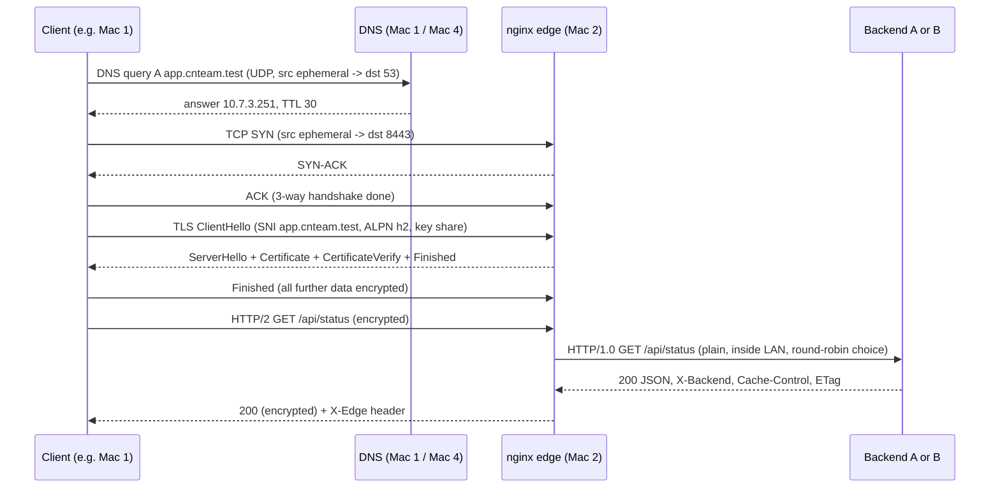

# Study Guide: Team Axis Private Network Platform

One document to understand **everything we built, why it works, what we measured, what went wrong, and how
to answer the viva**. Read it top to bottom once, then use §9–§10 to revise.

> The viva tests the **whole system**, not just your own machine. Every member should be able to explain every section.

**Contents:** 1 Project in 60 s · 2 Machines · 3 One request, step by step · 4 Phase 1 · 5 Phase 2 ·
6 Real problems we hit · 7 Troubleshooting playbook · 8 Command cheat sheet · 9 Final demo runbook ·
10 Viva questions and answers · 11 Glossary · 12 Where things are

---

## 1. The project in 60 seconds

We built a small private "cloud" on four MacBooks on the campus Wi-Fi, with no real cloud and no pre-built servers.
A client types `https://app.cnteam.test:8443`:

1. **Our own DNS server** (Mac 1) turns the name into Mac 2's IP.
2. The client opens a **TCP** connection to Mac 2 and does a **TLS** handshake with our certificate.
3. **nginx on Mac 2** (the "edge") decrypts the request and **load-balances** it round-robin to one of two
   **backend** servers (Mac 3 or Mac 4).
4. The backend answers with JSON plus an `X-Backend: A|B` header, so we can see the load balancing.

The app is deliberately trivial. **The network is the project.**
- **Phase 1 (Build & Observe):** build it and prove every layer with packet captures.
- **Phase 2 (Harden & Recover):** keep it working while parts fail (backup DNS, TTL, firewall isolation,
  failover, migrating to a standby edge) and diagnose faults layer by layer.

| Cloud concept | Our version |
|---|---|
| Route 53 (managed DNS) | dnsmasq on Mac 1 (+ backup on Mac 4) |
| ALB / GCP Load Balancer / CDN edge | nginx on Mac 2 (+ standby on Mac 3) |
| EC2 app instances in a target group | Backend A (Mac 3 :3001), Backend B (Mac 4 :3002) |
| Security group "allow only from the LB" | pf firewall rules on Mac 3 / Mac 4 |
| ACM certificate on the LB | self-signed cert for `app.cnteam.test`, trusted on every Mac |
| DNS-based blue/green cutover | Ext E: repoint `app.cnteam.test` to the standby edge |

## 2. The machines

| Machine | Owner | Role | Ports | Phase 1 IP | IP on 22 Nov |
|---|---|---|---|---|---|
| Mac 1 | Kartikey | primary DNS (dnsmasq) + test client | UDP 53 | 10.7.8.82 | 10.7.22.176 |
| Mac 2 | Agnik | edge: nginx reverse proxy + load balancer + TLS | TCP 8080 → 8443 | 10.7.14.242 | 10.7.3.251 (later 10.7.20.195) |
| Mac 3 | Vishuti | Backend A + (Phase 2) standby edge | TCP 3001 (+ 8443 standby) | 10.7.18.246 | 10.7.15.127 |
| Mac 4 | Anwesha | Backend B + (Phase 2) backup DNS + test client | TCP 3002, UDP 53 | 10.7.5.197 | 10.7.19.42 |

- Network: campus Wi-Fi `10.7.0.0/19` (mask 255.255.224.0), gateway `10.7.0.1`, interface `en0`.
- Domain: `app.cnteam.test` and `api.cnteam.test` → **always Mac 2** (the edge), never a backend.
- **`.test`, not `.local`:** `.test` is reserved for testing (RFC 6761). macOS uses `.local` for mDNS/Bonjour,
  which would bypass our DNS server.
- **8080/8443, not 80/443:** ports below 1024 are privileged. Homebrew nginx runs without sudo, so it uses 8080/8443.
  The course allows this substitution.
- **IPs change between sessions** (DHCP). Before every session: everyone posts `ipconfig getifaddr en0`,
  updates `team.env`, and the DNS records, nginx upstreams and firewall allow-lists are re-rendered.

## 3. One request, step by step (know this cold)



| Step | Layer (TCP/IP · OSI) | What happens | Port | Proved with |
|---|---|---|---|---|
| 1–2 | Application · 7 | DNS query/answer (A record) | UDP 53 | `dig`, Wireshark filter `dns` |
| 3 | Transport · 4 | TCP 3-way handshake: SYN → SYN-ACK → ACK | TCP 8443 | Wireshark `tcp.flags.syn==1` |
| 4 | between 4 and 7 (often called session/presentation) | TLS 1.3 handshake, certificate check | TCP 8443 | `curl -v` (`SSL certificate verify ok`), Wireshark `tls.handshake` |
| 5 | Application · 7 | HTTP request, encrypted inside TLS | TCP 8443 | `curl -v` shows headers. Wireshark shows only "Application Data" |
| 6 | Application · 7 | nginx picks a backend, opens a new TCP connection to it | TCP 3001/3002 | `X-Backend` header, edge access log |
| all | Network · 3 / Link · 2 | IP packets between LAN addresses, Wi-Fi frames by MAC address | — | Wireshark IP/Ethernet headers |

Key ideas:
- **DNS and the connection are separate steps.** DNS only finds the IP, then the client connects to that IP. Either can fail on its own.
- **Socket pair** = (client IP, ephemeral port, server IP, 8443). The ephemeral port is random (49152–65535 on macOS).
  The server port is fixed.
- **TCP comes before TLS, and TLS before HTTP:** TLS needs a reliable byte stream (TCP), and HTTP data must not be
  sent until encryption keys exist.
- **Why Wireshark shows the payload as encrypted but `curl -v` shows headers:** curl is the endpoint holding the
  session keys. Wireshark only sees ciphertext on the wire.
- **There are two TCP connections:** client↔edge (TLS) and edge↔backend (plain HTTP). TLS terminates at the edge.
  The backend sees the edge's IP as the client, and the real client arrives in `X-Forwarded-For`.
- **The client never knows backend IPs.** Only nginx's `upstream` block has them. That's what lets you add, remove or
  replace backends without touching clients.

## 4. Phase 1: Build & Observe (done in October)

### DNS (Mac 1, dnsmasq)
```
address=/app.cnteam.test/<MAC2_IP>     # A record for our names (also matches subdomains)
address=/api.cnteam.test/<MAC2_IP>
no-resolv
server=1.1.1.1                          # everything else goes upstream, so clients can still browse
log-queries                             # who asked what (evidence)
```
- **Clients:** System Settings → Wi-Fi → DNS = Mac 1's IP. macOS asks the system resolver (mDNSResponder).
- **`dig` asks a DNS server directly, while `dscacheutil` shows what the OS (and therefore curl and browsers) uses,
  including its cache.** This difference matters a lot in Phase 2.
- **DNS uses UDP 53** (small, one request and one reply, no handshake). It falls back to **TCP 53** when a response is
  too big (truncated flag set) and for zone transfers.

### Edge (Mac 2, nginx)
```nginx
upstream backend_pool { server <A>:3001 ...; server <B>:3002 ...; }   # round-robin by default
server { listen 8080; return 301 https://$host:8443$request_uri; }    # HTTP -> HTTPS
server {
  listen 8443 ssl;   ssl_certificate ...crt;   ssl_certificate_key ...key;
  location / { proxy_pass http://backend_pool; proxy_set_header Host $host;
               proxy_set_header X-Forwarded-For $remote_addr; }
}
```
- **Reverse proxy:** clients talk only to the edge, and the edge talks to the backends. (A *forward* proxy acts for
  clients going out, a *reverse* proxy acts for servers.)
- **Round-robin:** request 1 → A, 2 → B, 3 → A… Alternatives: `least_conn`, `ip_hash` (sticky), weights.

### TLS
- Self-signed certificate: `CN=app.cnteam.test`, **SAN** `app.cnteam.test, api.cnteam.test`, RSA-2048, 365 days.
  Browsers check the **SAN**, not the CN.
- Trusted on every Mac via Keychain (`security add-trusted-cert`), so **no `curl -k`** in the demo (`-k` skips verification).
- Live result: **TLS 1.3, `AEAD-CHACHA20-POLY1305-SHA256`**.
- **TLS 1.3 handshake (1 round trip):**
  - **ClientHello:** versions, ciphers, key share, SNI = name, ALPN = h2/http1.1.
  - **ServerHello:** chosen cipher and the server's key share. Both sides now derive the keys (ECDHE).
  - The server then sends **encrypted** EncryptedExtensions, **Certificate**, **CertificateVerify** (proves it holds
    the private key) and **Finished**.
  - The client checks the cert (trusted issuer? name in SAN? not expired?) and sends **Finished**.
  - The ChangeCipherSpec seen in TLS 1.3 captures is a dummy kept for middlebox compatibility.
- **The private key never leaves the edge.** The `.crt` is public, the `.key` is secret and never goes in git.

### Backends (Mac 3, Mac 4)
- Python standard library `http.server`, bound to **`0.0.0.0`**. `127.0.0.1` would accept only local connections,
  so nginx on another Mac couldn't reach it.
- `GET /` and `GET /api/status` → `{"backend":"A","status":"ok"}`, with headers `X-Backend: A` and `Cache-Control: max-age=60`.

### Caching
- **Fresh hit:** within `max-age=60` the browser reuses its copy and **sends no request at all** (DevTools shows "disk cache").
- **Conditional request:** once stale, the client sends `If-None-Match: "<etag>"` and the server replies **304 Not
  Modified** with no body.
- **Full request:** no cached copy, so 200 with the full body.

### Phase 1 failure demos (all 5 done)

| Break | Saw | Lesson |
|---|---|---|
| Client uses the wrong DNS server | name lookup fails, `ping <IP>` still works | DNS and IP are independent layers |
| DNS record → wrong IP | resolves "fine" but lands on the wrong host | DNS is a directory, not a connection |
| One backend stopped | all requests served by the other, no errors | the edge routes around failure |
| Both backends stopped | DNS + TLS fine, **502 Bad Gateway** (2 Oct, 13:04:02) | shows where the edge ends and the app begins |
| Client uses the wrong port | ping OK, `Connection refused` | IP addresses and ports are separate identifiers |

## 5. Phase 2: Harden & Recover (done 22 Nov)

### Ext A: Backup DNS (Kartikey drove the demo, Anwesha hosts the backup)
- **What:** a second dnsmasq on Mac 4 with **identical** records. Clients list Mac 1 then Mac 4.
- **Test (19:05):** stopped Mac 1's dnsmasq. Queries to Mac 1 got ICMP "port unreachable". `nslookup` showed
  `Server: 10.7.19.42`. curl by name (no `-k`) still returned HTTP/2 200.
- **Contrast (19:38–19:43):**
  - **Both DNS servers down:** `Resolving timed out`, yet the edge by IP still returned 200. That's a **DNS failure**.
  - **Both backends down:** DNS fine, TCP fine, TLS `verify ok`, **HTTP 502**. That's an **application failure**.
- **Why it matters:**
  - The backup must be on a different machine so the failures are independent.
  - macOS may query **either** server, so both must give the **same answer**. Production keeps name servers in sync
    with zone transfer (AXFR/IXFR) or a managed hosted zone.

### Ext B: TTL and controlled record change (Kartikey)
- **Phase 1 problem:** dnsmasq's default `local-ttl` is **0**, meaning "don't cache", so changes looked instant.
- **Change:** set `local-ttl=30` and confirmed on the wire (the `dig` TTL column went from 0 to 30).
- **Test:** changed the record at 18:39:44.
  - `dig` (asks the server) showed the new IP immediately.
  - `dscacheutil` (the OS cache) kept the **old IP until about 30 s later** (18:40:23).
  - curl kept reaching the old edge for that whole time.
- **Manual flush:** `sudo dscacheutil -flushcache; sudo killall -HUP mDNSResponder` makes the change take effect instantly.
- **Lesson:**
  - TTL = how long resolvers and clients may cache an answer. A change takes up to one TTL to reach everyone.
  - Production lowers the TTL **before** a migration (the old TTL must expire first), cuts over, then raises it again.
  - Existing TCP / keep-alive connections never re-resolve.

### Ext C: Service isolation with the pf firewall (Vishuti lead, Anwesha for 3002)
- **Goal:** backends reachable **only from the edge tier**, never directly by clients (the security-group idea).
- **Mac 3** used an **anchor** so Apple's own rules stay intact:
  ```
  table <edges> { <MAC2_IP> }
  pass in quick on lo0 proto tcp from any to any port 3001          # local + standby edge via 127.0.0.1
  pass in quick proto tcp from <edges> to any port 3001 keep state  # the edge tier
  block return in quick proto tcp from any to any port 3001         # everyone else gets a TCP RST
  ```
  Enabled with `pfctl -E` (returns a token) and released with `pfctl -X <token>`. The ruleset was backed up before enabling.
- **Mac 4:** allowed Mac 2 **and Mac 3** (the standby edge needs to reach Backend B), and blocked others by dropping.
- **Results:**
  - Mac 1 → 3001: **Connection refused** (`block return`).
  - Mac 1 → 3002: **Operation timed out** (drop).
  - Mac 2 → both: allowed, and load balancing still alternated.
  - Rollback was confirmed from Mac 1 at 19:36:23.
- **Know the difference:**
  - `block return` sends an RST, so the client gets an instant "refused": explicit and easy to diagnose.
  - `block drop` is silent, so the client waits for a timeout: stealthier and harder to diagnose.
  - `quick` stops at the first match. Without `quick`, the **last** matching rule wins.
  - `keep state` lets the replies back in.
- **Gotcha we hit:** Mac 4's first ruleset also blocked its **own outgoing** connections (`No route to host`). A host
  firewall must pass outgoing traffic statefully and touch only the service port.

### Ext D: HA failover (Agnik)
- **Config:**
  ```nginx
  server <A>:3001 max_fails=1 fail_timeout=10s;   # 1 failure -> skip this backend for 10 s
  proxy_next_upstream error timeout http_502 http_503 http_504;   # retry the request on the other backend
  proxy_next_upstream_tries 2;  proxy_connect_timeout 2s;  proxy_read_timeout 5s;
  ```
- **Test:** Backend A was down from 18:48:13 to 18:48:59 (46 s). Every request was served by B: **252/252 HTTP 200**
  over 5 minutes.
- **Edge log evidence:**
  - nginx re-tried A at 18:48:14, :29 and :44 and got `Connection refused` each time.
  - Each of those requests shows `upstream=A:3001, B:3002`, meaning the **retry happened inside the same request**,
    so the client never saw an error.
  - A rejoined after it restarted.
- **The type of failure sets the cost** (measured in a local pre-test):

  | Failure | Cost of the first request |
  |---|---|
  | refused (process stopped) | ~0 |
  | silent host (powered off or packets dropped) | one 2 s connect timeout |
  | hung app (accepts, never replies) | one 5 s read timeout |

  After that first failure, the backend is skipped for 10 s.
- **Passive vs active health checks:** nginx open source learns only from **real failed requests**. AWS ALB and
  nginx Plus **probe on a timer**.
- **SPOF:** the edge itself. If Mac 2 dies, DNS still resolves but nothing answers. To fix it, use one of:
  - two active edges + health-checked DNS failover (Route 53 failover records)
  - a floating VIP with VRRP/keepalived
  - anycast
  - a managed multi-AZ load balancer

### Ext E: DNS-based edge migration (Agnik built it, Vishuti hosted, Kartikey + Anwesha changed DNS)
- **The standby:** nginx on Mac 3, rendered from the **same template** as the primary (same cert **and key**), with
  `X-Edge: mac3-standby` instead of `mac2-primary`.
- **Why the same key:** clients trust that specific certificate. Only the matching private key can complete the handshake.
- **Run 1 (Mac 1's DNS only):**
  - Cutover at 18:57:53, and the client flipped to the standby at 18:58:20 (**27 s**, inside TTL 30).
  - The primary's log stops at 18:58:17, and the standby's log starts at 18:58:20.
  - Cut back after 27 s. **90/90 requests OK.**
  - Mistake found: the backup DNS wasn't changed.
- **Run 2 (both DNS servers):**
  - Mac 1 at 19:18:42, Mac 4 at 19:18:52.
  - Flip 30 s later each way. **105/105 OK.**
  - On the way back Mac 4 reverted about 30 s before Mac 1, so the servers disagreed briefly.
- **Lessons:**
  - A DNS cutover is manual and bounded by the TTL. It is migration, not automatic failover.
  - Keep the old edge running until its traffic drains, because keep-alive connections stay put.
  - Change every name server from one place.

### Ext F: Troubleshooting (everyone)
- **Order:** DNS → IP → TCP → TLS → HTTP → backend (§7).
- **Real silent fault we found:**
  - Mac 4 answered `10.7.15.127` while Mac 1 answered `10.7.3.251`.
  - Nothing broke, because the standby was healthy, so redundancy hid the fault.
  - We caught it only because we compare both servers explicitly.
- **Tools:**
  - `tools/diagnose.sh` (Anwesha): 9 layers, stops at the first failure.
  - `backend_a/scripts/troubleshoot.sh` (Vishuti)
  - `mac1-kartikey-dns/scripts/f-dns-check.sh` (Kartikey)
  - `mac2-agnik-nginx-edge/scripts/team-check.sh` (Agnik)

### Phase 1 gaps closed in Phase 2
- **304:** added `/api/info`. Its body is **byte-identical on A and B**, so the ETag (`"39464b4ed106dad1"`) is the same
  and a 304 comes back whichever backend answers. `/api/status` differs per backend, so its ETags differ and round-robin
  would break revalidation.
- **HEAD:** Backend B had no `do_HEAD`, so `curl -I` returned **501** half the time. Fixed.
- **HTTP/2:** `http2 on;` gives `ALPN: server accepted h2` and `HTTP/2 200`.
  - Benefits: binary framing, multiplexing many requests on one connection, HPACK header compression.
  - HTTP/3 runs over QUIC on UDP (explanation only).
- **No `-k`:** all Phase 2 evidence goes through real DNS and the trusted certificate.

## 6. Real problems we hit (great viva material)

| Problem | Symptom | Real cause | Layer | Fix |
|---|---|---|---|---|
| DHCP gave every Mac a new IP | DNS dead, the edge returned 504/502, the standby served A only | `bind-interfaces` on the old IP, stale upstream IPs, standby pointed at Anwesha's old IP | Network/config | IP sync each session, render from `team.env`, `interface=en0` |
| DNS servers disagreed | no errors, some clients on the wrong edge | leftover record from practising the cutover | DNS data | compare servers (`sync-check`), change both together |
| Firewall blocked its own host | `No route to host` from Mac 4 outward | pf dropped outgoing packets | Host firewall | `pass out quick all keep state`, port-only rules |
| `curl -I` returned 501 | half the HEAD requests failed | Backend B had no HEAD handler | Application | shared `do_HEAD` |
| 304 only sometimes | 200 instead of 304 | different ETags per backend | HTTP | identical `/api/info` body |
| Record changes instant in Phase 1 | caching never visible | `local-ttl` = 0 | DNS | `local-ttl=30` |
| Script said "nginx not running" | reload skipped | nginx renames its processes, so `pgrep -x nginx` never matches | Tooling | check the PID file |

Big lesson: **"it works" isn't proof of health.** Failover hides faults. Check that both backends appear in `X-Backend`,
that both DNS servers agree, and that the nginx error log is clean.

## 7. Troubleshooting playbook (Ext F, the faculty-injected fault)

Say each step out loud: *what you ran, what it showed, what that proves.* Partial credit goes to method.

| # | Layer | Command | Good | Bad → likely cause |
|---|---|---|---|---|
| 1 | Resolver | `scutil --dns \| grep nameserver`, `grep cnteam /etc/hosts` | team DNS IPs, no override | wrong resolver / hosts override |
| 2 | DNS | `dig @<MAC1> app.cnteam.test`, `dig @<MAC4> …`, `dscacheutil -q host -a name app.cnteam.test` | both = edge IP, and they agree | timeout = dnsmasq down · wrong IP = bad record · NXDOMAIN = record missing · dig≠dscacheutil = cache/hosts |
| 3 | IP | `ping -c2 <edge IP>` | replies | host down / wrong IP |
| 4 | TCP | `nc -vz -G 3 <edge IP> 8443` | succeeded | refused = nginx down / wrong port · timeout = firewall/host |
| 5 | TLS | `openssl s_client -connect <IP>:8443 -servername app.cnteam.test </dev/null` · `curl -v` | `Verify return code: 0`, `SSL certificate verify ok` | untrusted / wrong cert / name not in SAN / expired |
| 6 | HTTP | `curl -i https://app.cnteam.test:8443/api/status` | 200 | **502** = all backends refused · **504** = backend timeout · 404 = wrong path |
| 7 | Balancing | 6× curl, count `X-Backend` | A and B | only one → a backend is down or out of the pool (silent!) |
| 8 | Backend | on Mac 2: `nc -vz <A> 3001`, `nc -vz <B> 3002` · on the backend: `lsof -nP -iTCP:3001 -sTCP:LISTEN`, `pfctl -sr` | open, bound to `*` | stopped / bound to 127.0.0.1 / pf blocks the edge / stale IP |
| 9 | Logs | `tail /opt/homebrew/var/log/nginx/error.log`, dnsmasq query log | clean | the real reason is usually written here |

**Practice faults:**
- **DNS:** wrong A record · both dnsmasq stopped · client resolver = 8.8.8.8 (NXDOMAIN for `.test`) · `/etc/hosts`
  override (dig OK, curl wrong)
- **Edge:** nginx stopped · upstream port wrong (no errors, only B) · both upstreams wrong (502) · different cert (TLS
  error) · `listen 8444` (refused)
- **Backend:** bound to 127.0.0.1 (only B) · pf with a stale edge IP + drop (2 s slow, then B)
- **Client:** cert removed from the Keychain · URL uses `:443` (refused)

## 8. Command cheat sheet

```bash
ipconfig getifaddr en0                         # my IP
dig app.cnteam.test +noall +answer             # server answer + TTL (bypasses the OS cache)
dig @10.7.19.42 app.cnteam.test +short         # ask one specific DNS server
dscacheutil -q host -a name app.cnteam.test    # what curl/browsers will use (OS cache)
sudo dscacheutil -flushcache; sudo killall -HUP mDNSResponder   # flush the DNS cache
nc -vz -G 3 <ip> <port>                        # is the TCP port open?
curl -v https://app.cnteam.test:8443/api/status          # TLS + headers (never -k in the demo)
curl -sI --http2 https://app.cnteam.test:8443/           # HTTP/2 + headers only
curl -sI -H 'If-None-Match: "39464b4ed106dad1"' https://app.cnteam.test:8443/api/info   # expect 304
for i in $(seq 10); do curl -s -D - -o /dev/null https://app.cnteam.test:8443/api/status | grep -i x-backend; done
openssl s_client -connect <ip>:8443 -servername app.cnteam.test </dev/null | grep -E "subject|Verify"
nginx -t && nginx -s reload                    # test + graceful reload of the nginx config
sudo pfctl -s info | head -2; sudo pfctl -sr   # pf on? which rules?
lsof -nP -iTCP:3001 -sTCP:LISTEN               # who listens on 3001, on which address
```
Wireshark filters: `dns` · `tcp.port==8443` · `tcp.flags.syn==1` · `tls.handshake.type==1` (ClientHello) · `tls.handshake.type==2` (ServerHello).

## 9. Final demo runbook (PDF §8)

Before starting:
- Do the **IP sync** and update DNS records, upstreams and firewall allow-lists.
- Point every Mac's DNS at Mac 1 + Mac 4.
- Run `team-check.sh` until it's all OK.
- Open the Wireshark captures.
- Reinstall the standby on Mac 3 if you'll show Ext E (`standby-edge/install-standby.sh` + the key by AirDrop).

| # | Step | Who | Show |
|---|---|---|---|
| 1 | Topology + IP table | Agnik | `ARCHITECTURE.md` with today's IPs |
| 2 | All on the LAN | everyone | ping each other |
| 3 | Resolve the name | Kartikey | `dig app.cnteam.test` → edge IP, `SERVER:` = Mac 1 |
| 4 | HTTPS by name, no warning | Anwesha | browser padlock + `curl -v` (`verify ok`, no `-k`) |
| 5 | Load balancing | Anwesha | 10× curl → A B A B |
| 6 | Wireshark DNS/TCP/TLS | Anwesha + Agnik | query/answer, SYN/SYN-ACK/ACK, ClientHello/ServerHello |
| 7 | Caching | Vishuti | `curl -I` → `Cache-Control`, then `If-None-Match` → **304** |
| 8 | Fail one backend | Agnik + Vishuti | `d-demo.sh` running, stop A → B only, 0 errors → restart → A/B |
| 9 | Phase 2 DNS resilience | Kartikey + Anwesha | backup failover (A), TTL (B), or cutover (E) |
| 10 | Faculty fault | everyone | §7 playbook, out loud |
| 11 | Viva | everyone | §10 |

## 10. Viva questions and answers

**DNS**
- *DNS resolution vs the connection?* DNS only maps name → IP (UDP 53). Then a separate TCP connection goes to that IP.
  They fail independently: with DNS down you get "could not resolve", with the app down DNS is fine and you get refused or 502.
- *Why UDP for DNS?* It's one small request and one reply, so a TCP handshake would triple the latency. It uses TCP for
  large or truncated answers and zone transfers.
- *Wrong resolver vs wrong record?* Wrong resolver: lookups fail (or `.test` gets NXDOMAIN from public DNS). Wrong
  record: lookups "succeed" but send you to the wrong host.
- *What is TTL, and what did you see?* It's how long caches may keep an answer. After the change the client kept the
  old IP about 30 s (TTL 30), then switched. A flush switched it instantly.
- *Why was Phase 1 instant?* dnsmasq `local-ttl` defaults to 0, meaning don't cache.
- *Why lower the TTL before a migration?* Clients may have cached the old answer with the old, long TTL. You wait that
  out first, so the cutover then spreads within the short TTL.
- *Why must both DNS servers match?* Clients may ask either one. If they differ, users get random behaviour. We actually
  saw this: Mac 4 pointed at the standby while Mac 1 pointed at the primary.
- *DNS failure vs application failure?* DNS failure: `Could not resolve host`, no packet reaches the edge, the edge is
  fine by IP. Application failure: resolves, TCP and TLS work, then **502**.
- *Why `dscacheutil` and not `dig` for TTL demos?* `dig` bypasses the OS cache and asks the server. curl and browsers
  use the OS cache.

**TCP / ports**
- *3-way handshake?* SYN (client picks an initial sequence number) → SYN-ACK (server's ISN, acknowledges client ISN+1)
  → ACK. Only then does data flow.
- *How does TCP make delivery reliable?* Sequence numbers, acknowledgements, retransmission on timeout or duplicate
  ACKs, a receive window for flow control, and congestion control.
- *Socket pair?* Client IP + ephemeral port ↔ server IP + 8443. It uniquely identifies the connection.
- *Wrong port demo?* Ping works (IP fine) but connect is refused: nothing listens on that port.
- *Refused vs timed out?* Refused = an RST came back (host up, port closed, or pf `block return`). Timeout = no
  answer (host down, or dropped by a firewall).

**TLS**
- *Walk through the handshake.* ClientHello (versions, ciphers, key share, SNI, ALPN) → ServerHello (key share) → both
  derive the keys → encrypted Certificate, CertificateVerify, Finished → client verifies the cert and sends Finished.
  It's 1-RTT in TLS 1.3.
- *What does the client verify?* That the chain is trusted (our cert is in the Keychain), the name is in the SAN, the
  cert isn't expired, and CertificateVerify proves the server holds the private key.
- *Why no `-k`?* `-k` skips verification, which defeats TLS. We made the cert genuinely trusted.
- *Where does TLS terminate? Is edge→backend encrypted?* It terminates at nginx on Mac 2. Edge→backend is plain HTTP
  inside the private LAN. Production may re-encrypt it (end-to-end TLS / mTLS).
- *Why did the standby need the same key?* Clients trust that cert. Only the matching private key can complete the
  handshake. A new self-signed cert would be untrusted.
- *SAN vs CN?* Browsers verify names against the SAN. Ours covers `app.` and `api.cnteam.test`.

**HTTP / caching**
- *Fresh hit vs conditional vs full?* Fresh hit = no request (within max-age). Conditional = `If-None-Match` → 304 with
  no body. Full = 200 with the body.
- *Why `/api/info` for the 304 demo?* Its body is identical on both backends, so the ETag matches whichever backend
  answers. `/api/status` differs per backend.
- *What does `X-Backend` prove? `Cache-Control`?* Which backend served the request (load balancing). That the response
  may be cached for 60 s.
- *HTTP/1.1 vs HTTP/2 vs HTTP/3?* HTTP/1.1: text, one request at a time per connection. HTTP/2: binary, multiplexed
  streams, header compression, negotiated via ALPN `h2`. HTTP/3: over QUIC (UDP), so there's no TCP head-of-line blocking.
- *Why was `curl -I` returning 501?* Backend B didn't implement HEAD.

**Load balancing and failover**
- *Why doesn't the client need backend IPs?* It only knows the edge's name and IP. nginx's upstream has the backends,
  so they can change freely.
- *What happens when A dies?* The first request fails on A (refused), nginx retries it on B within the same request (the
  client still gets 200), and A is marked down for 10 s. Later requests go only to B until A answers again.
- *Passive vs active health checks?* Passive learns from real failed requests (nginx open source). Active probes on a
  timer (ALB, nginx Plus).
- *Why did a silent failure cost 2 s?* There was no RST, so nginx waited out `proxy_connect_timeout 2s` before retrying.
- *Single point of failure?* The edge (Mac 2). Fixes: two active edges + health-checked DNS failover, a VIP with
  VRRP/keepalived, anycast, or a managed multi-AZ load balancer.
- *Map nginx to an ALB.* upstream = target group, server lines = targets, max_fails/fail_timeout = health check
  thresholds, the listener on 8443 with the cert = HTTPS listener + ACM cert, proxy_next_upstream = retry policy.

**Firewall / isolation**
- *Explain the pf rules line by line.* Pass loopback → pass the edge-tier table with state → block everyone else on the
  port. `quick` = stop at the first match.
- *Why doesn't the firewall block nginx?* nginx's source IP is in `<edges>`. If Mac 2's IP changes, you must update the
  table, or nginx gets blocked and the edge fails over or returns 502.
- *`block return` vs `block drop`?* RST → instant "refused" vs silence → timeout. `return` is easier to debug, `drop`
  hides that the host exists.
- *Why did Mac 4 get "No route to host"?* Its first ruleset blocked outgoing traffic. pf reports blocked outgoing
  packets locally as host-unreachable.
- *Cloud equivalent?* A security group that allows the backend port only from the load balancer's security group.

**Whole system**
- *Edge down vs backend down vs DNS down: what does the client see?* Edge down: resolves, then TCP refused or timeout.
  Backend(s) down: resolves, TLS OK, 502 (or nothing visible if one survives). DNS down: "could not resolve host".
- *Why do keep-alive connections ignore a DNS change?* DNS is looked up only when a new connection opens. An open TCP
  connection stays with its server.
- *What's still not redundant?* The edge, the single Wi-Fi access point/subnet, the one shared cert/key, and
  passive-only health checks.

## 11. Glossary

- **A record:** name → IPv4 address.
- **TTL:** cache lifetime of a DNS answer.
- **Resolver:** the client-side DNS lookup service (mDNSResponder on macOS).
- **Reverse proxy:** a server that accepts client connections and forwards them to backends.
- **Upstream:** nginx's pool of backends.
- **Round-robin:** take turns between backends.
- **TLS termination:** decrypting at the edge.
- **SNI:** the server name sent in ClientHello.
- **ALPN:** protocol negotiation (h2 / http1.1) inside TLS.
- **SAN:** the names a certificate is valid for.
- **ETag:** a version identifier for a response.
- **304:** "your cached copy is still valid".
- **502 Bad Gateway:** the edge couldn't get a valid response from any backend.
- **504 Gateway Timeout:** a backend didn't answer in time.
- **pf:** the macOS/BSD packet filter.
- **Anchor:** a named sub-ruleset in pf.
- **RST:** a TCP reset ("connection refused").
- **Ephemeral port:** a random client-side port.
- **SPOF:** single point of failure.
- **DHCP:** automatic IP assignment (why our IPs changed).

## 12. Where things are in the repo

| Need | Path |
|---|---|
| Final report with all numbers | `PHASE2_REPORT.md` |
| Topology / design | `ARCHITECTURE.md` |
| Every evidence file by task | `EVIDENCE_INDEX.md` |
| DNS configs, demo scripts, evidence | `mac1-kartikey-dns/` (`scripts/demo-*.sh`, `cutover.sh`, `f-dns-check.sh`, `evidence/phase2/`) |
| Edge template, failover/cutover scripts, evidence | `mac2-agnik-nginx-edge/` (`config/edge.conf.tmpl`, `scripts/d-demo.sh`, `team-check.sh`, `evidence/phase2/`) |
| Standby edge | `mac2-agnik-nginx-edge/standby-edge/` |
| Backend A, pf anchor, troubleshoot | `backend_a/` |
| Backend B, backup DNS config, pf rules | `backend_b/` |
| Team diagnosis tools | `tools/diagnose.sh`, `tools/watch.sh` |
